## Hi there 👋🏻

I'm Danburen,a normal 🧑‍🎓 college student in year 4 struggling not to be left by life

📖 Major in Software Engineering

🧱 Mainly studying in ☕Java & 💻 backend

**Status: Open to work**

I am currently actively looking for new opportunities in software development and game development. I am genuinely passionate about building things — whether it is a well-structured software project or an engaging game experience — and I would be very grateful for any opportunity to learn, contribute, and grow with a team.

If you know of any relevant openings, or if you would like to discuss how I might be a good fit, please feel free to reach out. I would truly appreciate it.

📫 Contact: 2964361672@qq.com

### 🛠️Main Project:
[VeloChatX](https://github.com/Danburen/VeloChatX) - A minecraft velocity server plugin tends to distribute players' messages with rich additional features

[NitroWater](https://github.com/Danburen/nitrowater) - One-stop platform for Minecraft server owners — server toolbox, plugin centre and AI assistant, behind a self-hosted SSO / OIDC identity centre.

[WaterFun](https://github.com/Danburen/WaterFun/tree/main) - A new era diversified interactive forum.

### ☎️ Content Me:
[QQ](https://qm.qq.com/q/fM0Pou10gE) / 
[Bilibili](https://space.bilibili.com/446337357?spm_id_from=333.1007.0.0) /
[outlook](mailto:hc2964361672@outlook.com) /
[QQMail](mailto:2964361672@qq.com)

 

